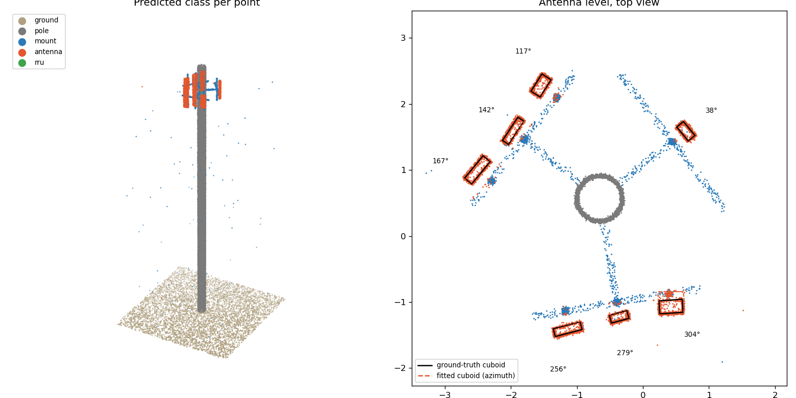

# Telecom Tower Point Cloud Segmentation

Finds panel antennas on a telecom tower point cloud and fits a 3D cuboid to each,
returning position, size, height and azimuth. Drone inspection teams produce
these measurements for a tower's digital twin.



I annotate and model tower equipment from drone point clouds at work. Client scans
can't be shared, so this project builds its own **synthetic towers** (monopole,
three sectors, mounts, panel antennas, RRUs), complete with the problems real scans
have:
- uneven point density
- 1–2.5 cm noise
- floating outliers
- antennas whose back faces the drone barely saw
- antennas bolted close enough to their pipes to touch

## Pipeline

1. **Ground removal:** RANSAC plane fit on the lowest 30 % of the cloud.
2. **Pole extraction:** least-squares circle fits on horizontal slices; median axis and radius.
3. **Per-point classification:** eigenvalue features of each point's 24-neighbourhood
   (linearity, planarity, scattering, verticality), plus height and distance from
   the pole, fed to a random forest. Pipes come out linear, panels planar.
4. **Antenna instances:** DBSCAN on antenna points, with the radius set from
   measured point spacing. Blobs shorter than 0.6 m are rejected.
5. **Cuboid fitting:** facing direction from PCA in plan view, extents from
   2nd–98th percentiles in that rotated frame. Azimuth measured from the pole axis.

## Results

30 held-out synthetic towers, classifier trained on 60 (`python evaluate.py`, ~40 s):

| Metric | Value |
|---|---|
| Ground / pole point IoU | 0.985 / 0.995 |
| Point classification macro-F1 (mount, antenna, RRU) | **0.953** |
| Antenna detection recall / precision (3D IoU ≥ 0.25) | **0.983 / 0.887** |
| Antenna azimuth error (mean) | **0.24°** |
| Facing direction error (mean) | 3.5° |
| Centre position error (mean) | 9.2 cm |
| Height error (mean) | 18.1 cm |
| Mean 3D IoU of matched cuboids | 0.57 |

3D IoU is a harsh metric for panels 10–20 cm deep. A few centimetres of noise on
the front and back faces costs a lot of overlap even when the box is visually right.

## What changed along the way

The first version clustered everything off the pole and then classified whole
clusters. On clean data it scored a perfect F1, which only showed that the data was
too easy. With realistic scans, antennas near their pipes merged with the mount into
one cluster, and recall fell to 0.58. Classifying points first and grouping
afterwards fixed that (recall 0.98). Switching the cuboid yaw from a minimum-area
rectangle to PCA cut facing error from 7.5° to 2.5°, and on the same 15-tower check
it raised precision from 0.86 to 0.92.

## Run it

```bash
pip install -r requirements.txt
python evaluate.py --train 20 --test 5   # quick run
python evaluate.py                       # full run, writes media/metrics.json
python -m pytest -q
```

## Layout

```
towerseg/synth.py     synthetic tower generator with per-point labels and true cuboids
towerseg/pipeline.py  RANSAC plane, circle fit, point features, DBSCAN, cuboid fit, 3D IoU
evaluate.py           train / test / metrics / figure
tests/                unit tests for each geometric step
```

## Next steps

- Lattice towers and microwave dishes
- Test on public LiDAR or photogrammetry scans
- Replace the hand-made features with a point-cloud network (PointNet++ / KPConv)
  once there is enough labelled real data

**Keywords:** point cloud segmentation, 3D object detection, LiDAR, photogrammetry,
drone inspection, telecom tower, digital twin, RANSAC, DBSCAN, PCA, random forest,
3D bounding box, cuboid annotation, Python, scikit-learn, NumPy, OpenCV.
